# UniHelp

UniHelp triages maintenance reports for Juniper Court, a fictional university residence. Residents need a grounded answer or the right next step. Residence staff need enough evidence to act without opening duplicate jobs or missing urgent reports. UniHelp proposes repairs, checks existing jobs, answers handbook questions and drafts replies in a Streamlit inbox. When the model confirms a fire or gas emergency with a quote found in the report, preset guidance is posted in the inbox straight away. Staff review proposed job actions and routine replies before they take effect.

```mermaid
flowchart LR
    I[Resident report] --> S[Load report and trusted context]
    S --> M[Assess safety and interpret with open jobs]
    M -->|Uncertain or conflicts with intake rules| V[Run separate safety check]
    M -->|Routine| R[Retrieve handbook passages]
    V -->|Routine| R
    M -->|Safety or spam review| P[Apply Python policy]
    V -->|Safety or spam review| P
    R --> P
    P --> D[Prepare proposal and reply]
    D -->|Verified fire or gas emergency| E[Post preset guidance in the inbox]
    D --> H[Pause for staff review]
    H --> A[Validate and apply staff decision]
    A -->|Edit or clarification| H
    A -->|Final decision| C[Save receipt]
```



## Quickstart

Use Python 3.12 and an existing [LM Studio local API server](https://lmstudio.ai/docs/developer/openai-compat/tools) with `qwen/qwen3.5-9b` loaded.

```sh
make setup BOOTSTRAP_PYTHON=python3.12
cp -n .env.example .env
# Set UNIHELP_SEED_SAMPLE=true in .env and point UNIHELP_DB at a fresh database.
make test
make run
```

For a hosted provider, set `UNIHELP_PROVIDER=openai` with `OPENAI_API_KEY`, or `UNIHELP_PROVIDER=vertex` with `GOOGLE_CLOUD_PROJECT` and either `GOOGLE_API_KEY` or Google Application Default Credentials. Optional Vertex embeddings use Application Default Credentials.

Open the Streamlit URL printed in the terminal. In **Inbox**, open a sample report and review the proposed action, evidence and draft. Approve or edit the proposal, then inspect the saved decision in **Handled** or the updated proposal in **Needs review**. The [running guide](docs/running.md) covers LangGraph Studio, the optional worker and additional provider settings.

## Evaluation results

A good run assigns the right route and urgency, uses a verified job when following up, grounds any reply in the report or policy, and keeps job changes and routine replies behind staff approval.

| Vertex AI triage experiment | Deterministic checks | What the run covered |
| --- | ---: | --- |
| [Full v3 run before routing fixes](evals/results/vertex-gpt-triage-v2.json) | 190/195 | 65 cases × 3 trials. Portable lighting failed all three trials. Two other cases missed the expected route once each. |
| [Targeted rerun after routing fixes](evals/results/vertex-routing-fixes.json) | 24/24 | The three failed cases and five controls × 3 trials. |
| [Full run after routing fixes](evals/results/vertex-full-post-fix.json) | 195/195 | The same 65 cases × 3 trials, same dataset fingerprint and model. |

All three runs used Gemini 3.1 Flash-Lite. After reviewing the failures, the policy was tightened to clarify reports that mention only portable lighting, route follow-ups without a verified matching repair to staff, and reject approval instructions embedded in a proposed split issue. The targeted rerun checks those fixes on the selected cases, and the full rerun confirms no other case regressed. The fixes were written against these cases, so 195/195 shows the regressions are closed, not that new reports will route correctly. The safety holdout is the test of that. Handbook recall@3 was 0.95 and hit@1 0.68 in both full runs, counting only trials where a handbook search ran; urgent handoffs skip the search by design. [Experiment notes](evals/results/README.md#rubric-v3-and-routing-fixes).

Both full runs caught all 22 labeled triage hazards in every trial. The separate holdout below tests different hazard paraphrases and look-alikes, and currently has results for intake rules alone.

### Earlier chase experiments

The historical overdue chase passed 3/3 trials on both agent versions using Qwen 3.5 9B. It verifies the integration on one report.

| Historical smoke case | [Original](evals/results/baseline-smoke-overdue.json) | [Unified graph](evals/results/current-smoke-overdue.json) |
| --- | ---: | ---: |
| Overdue ceiling light chase, v1 | 3/3 (27.6 s median) | 3/3 (8.8 s median) |

The hosted v2 chase subset used the same pinned dataset version, Qwen 3.5 9B and three trials per case.

| V2 chase subset | [Pinned baseline](https://smith.langchain.com/o/84ac8070-9fc2-4628-86a1-bd1930514885/datasets/41973756-a698-4a88-b7e2-2b4675a5df8c/compare?selectedSessions=cf4695d8-b976-47d6-a1a1-4dc95df9e748) | [Unified graph](https://smith.langchain.com/o/84ac8070-9fc2-4628-86a1-bd1930514885/datasets/41973756-a698-4a88-b7e2-2b4675a5df8c/compare?selectedSessions=2b5375a5-e61b-4000-b90a-81d2eb22843b) |
| --- | ---: | ---: |
| Normal (1 case) | 3/3 | 3/3 |
| Ambiguous (2 cases) | 4/6 | 3/6 |
| Median latency | 22.6 s | 10.0 s |

| V2 chase ablation (8 cases × 3 trials) | [Without follow-up](evals/results/chase-v2-without-followup.json) | [With follow-up](evals/results/chase-v2-with-followup.json) |
| --- | ---: | ---: |
| Correct model nomination | 6/24 | 9/24 |
| All core checks passed | 15/24 | 12/24 |
| Median latency | 4.9 s | 9.8 s |
| Model calls | 27 | 45 |

| Safety holdout | Hazards caught | Look-alikes flagged |
| --- | ---: | ---: |
| Intake rules alone | 3/34 | 3/12 |

## Three failures

- **Wrong job on a chase.** The model nominated the open ceiling light job when the resident named a wall light. Python now requires evidence of the same fitting before escalation. [Trace](https://smith.langchain.com/public/a5702ff3-1bbb-4ea6-a53a-0aa032832f08/r) · [failure log](docs/failures.md).
- **Off-topic policy lookups.** Using search topics instead of rule IDs made requests valid, but some still targeted the wrong topic. [Trace](https://smith.langchain.com/public/43ce3978-efe3-45b9-aee5-cc2e784b42c0/r) · [failure log](docs/failures.md).
- **Paraphrased evidence.** The model asked the right follow-up question but quoted wording absent from the resident’s report. [Trace](https://smith.langchain.com/public/a37130d0-91f5-48cd-a23b-3832d26faa28/r) · [failure log](docs/failures.md).

## How it is evaluated

I wrote the [30 resident-message cases](evals/resident-message-cases.json) by hand, including their expected outcomes. I manually reviewed the cases and expected outcomes in the other evaluation datasets.

The [v3 triage dataset](evals/dataset.json) contains 65 synthetic English reports, with 13 normal, 12 edge, 22 hazard, 10 ambiguous and 8 adversarial cases. Five are handbook questions, including two the handbook cannot answer. The [safety holdout](evals/safety_holdout.json) adds 34 hazard paraphrases and 12 look-alikes. Each report runs three times with fixed inputs and separate expected outcomes.

[Deterministic checks](evals/evaluators.py) cover routes, urgency, job matching, deadlines, literal evidence and writes before approval. Trajectory checks record who initiated each lookup, how many model calls ran and whether the model nominated the right job before Python checked it. Retrieval recall@3 and hit@1 check handbook passages, and the [retrieval sweep](evals/retrieval_sweep.py) measures the same production query without a chat model. With `--agent vertex --judge`, Gemini on Vertex AI drafts the reply and a separate GPT evaluator scores grounding, unsupported promises and whether the reply answers the resident. The [calibration runner](evals/calibrate.py) compares judge verdicts with reference labels. GPT scored six model drafts in each full Vertex run. It passed all three criteria on each draft in the first run and 17 of 18 verdicts in the post-fix run, failing grounding on a reply that assumed the resident had a job number. The revised rubric matched 21/21 Codex-assisted reference labels on each of the reused development and test splits. Independent human labeling and a fresh holdout are still pending. [Judge results and error analysis](evals/results/README.md#gpt-judge-contrast-check).

## Traces and reproducibility

Open the public traces below to inspect individual failures or use the LangSmith comparison links above for hosted experiments. For a local run, use an active model provider and run the overdue case. The HTML viewer shows the fixture, expected outcome and actual trial results.

```sh
make eval EVAL_ARGS="--case overdue --output /tmp/unihelp-overdue.json"
make eval-html EVAL_ARGS="--results /tmp/unihelp-overdue.json --output /tmp/unihelp-eval.html"
open /tmp/unihelp-eval.html
```

For hosted traces and evaluator feedback, configure `LANGSMITH_API_KEY` and follow the dataset sync and experiment commands in the [running guide](docs/running.md#live-experiments).

## Design choices and tradeoffs

The model interprets the report and Python applies [structured policy](unihelp/rules.json). Staff approve job actions and routine replies. Approval checks the job and policy again, and writes the result and receipt in one SQLite transaction. A repeated approval returns the original receipt.

The live graph usually assesses safety and interprets a report in one structured model call. A confirmed hazard goes to staff at the appropriate urgency, and an explicitly retracted joke can be marked as spam for staff confirmation. If the combined result is uncertain, invalid, or conflicts with intake signals, a separate safety check runs. If safety still cannot be verified, intake rules can raise the priority of staff review. The fallback does not post an automatic emergency reply.

Retrieval follows interpretation. Python builds one query from the resident’s words plus the interpreted intent, category and fitting, and a LangChain retriever searches the small [resident handbook](unihelp/handbook/resident-guide.md). BM25 always runs. Setting `UNIHELP_EMBEDDING_MODEL` adds an in-memory embedding index and fuses both rankings by reciprocal rank, which covers paraphrases and other languages; if the embedding service fails, search falls back to BM25.

Routine repairs and chases use reply templates filled with the verified policy target or the existing job record. Handbook answers still use the reply drafter, which may call `search_policy` for one extra round and must cite passages it was shown. Python checks citations, job numbers and dates before staff see the draft. Questions without a grounded answer go to staff.

The earlier agents searched during interpretation, first with `create_agent` and `ToolStrategy`, then with a hand-written tool loop. The chase ablation above measured that extra round at roughly double the model calls and latency with fewer passing trials on Qwen 3.5 9B, so the search moved to the reply step.

## Evaluating in production

Start in shadow mode with staff reviewing proposals and scoring them against the original report, job record and policy. Track wrong jobs, missed hazards, false urgent alerts, unnecessary questions, reviewer overrides and latency by route. Review urgent misses individually, turn recurring failures into regression cases and rerun those cases before changing the model, prompt or policy. Hosted traces record model ID, prompt hash, rule revisions and graph version. Review decisions can be sent back as trace feedback. The [review metrics command](evals/reviewer_metrics.py) summarizes SQLite activity without exporting messages.

## Limits

This is a single workspace demo without authentication, multi-tenancy, a distributed worker or external message delivery. The model can miss hazards or time out; staff remain responsible for reviewing the queue. A live run on the separate safety holdout remains open. The judge has limited coverage on live drafts, and independent human calibration is still pending. The embedding similarity floor is provisional until `evals.retrieval_sweep --hybrid` is run against a real embedding model, and keyword search alone still returns passages for questions the handbook cannot answer, so those rely on the drafter declining.

## How coding assistants helped

I designed and built UniHelp, wrote evaluation cases, and reviewed the results and failure traces myself. I used coding assistants as collaborators for implementation, debugging, and drafting additional test cases.

## Submission links

- Repository URL pending. This checkout has no configured Git remote.
- Screen recording link pending. The quickstart above gives a walkthrough of the same review flow.

## Reference

The Python package is named `unihelp`. See [running and evaluating UniHelp](docs/running.md) for Studio, workers, hosted runs, the guidance export demonstration and judge calibration. The [artifact index](evals/results/README.md) identifies the recorded runs.
